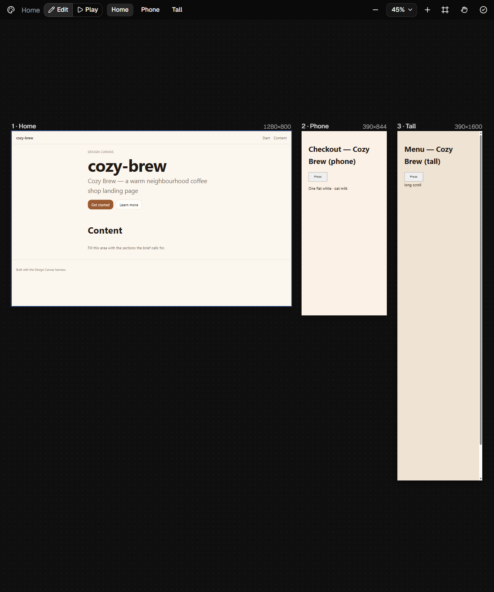

# Design Canvas

**A design wall for OpenChamber.** `/canvas <brief>` in any chat opens a real,
zoomable artboard canvas — multiple live screens side by side — and turns what
you click into instructions for your agent. An open, local take on Claude's
design tool: the screens are plain HTML files in your own Documents folder,
served by your own dev server, edited by whichever model OpenChamber is
already running.

[](LICENSE)
[](package.json)
[](https://github.com/sams-git-195/openchamber-design-canvas/actions/workflows/ci.yml)



## The 60-second tour

1. Open **any** chat in OpenChamber — no project, no setup — and type:
   `/canvas a landing page for a night-market coffee stall, two directions`
2. The canvas workspace is created at `Documents/Design Canvas/<name>`:
   a Vite skeleton, a design system (`DESIGN.md` + `tokens.css`), a dev
   server on a free loopback port — with progress toasts while it works.
3. A chromeless Chrome window opens: each *direction* is its own artboard,
   live and scrollable, laid out on a dot-grid wall you can pan and zoom.
4. Hover any element — it highlights with its selector and size. **Click it.**
   A reference chip lands in your chat: selector, markup, computed styles,
   which screen it came from. Type *"make this bigger"* — the agent edits the
   real file and the artboard hot-reloads.
5. Hit **Play** and the screens become a prototype: buttons and links work,
   click-throughs stay inside their artboard.
6. Right-click an artboard to rename it, zoom to it, export it, or send the
   whole screen to the chat. `/canvas export` writes exact-size PNGs and PDFs
   to `<workspace>/exports/`; `/canvas critique` posts a gate-backed review
   (contrast, overflow, tap targets, semantics) per screen.

## What you get

**The canvas**
- **One wall, many screens** — desktop, tablet, phone, poster, A4, 1080×1080:
  every screen is its own artboard at its own natural size, side by side for
  comparison. Variants and responsive sets are first-class.
- **Real, live HTML** — artboards are pages served by Vite with hot reload,
  not pictures. Text reflows, tabs work, hover states work.
- **Figma-style navigation** — pan both axes (drag or wheel), Ctrl/⌘+wheel
  zoom anchored at the cursor, fit-all, zoom-to-screen, dot grid, shadows,
  always-readable artboard labels at any zoom.
- **Drag to arrange** — artboard positions are canvas state, stored per
  workspace; your pan/zoom/active-screen/mode all reopen where you left them.
- **Live registry** — when the agent writes a new screen, its artboard
  appears within seconds, with a pulse. A broken `screens.json` says so in
  plain language instead of silently blanking.
- **Context menu per artboard** — send to chat · zoom · reload · reset
  position · export PNG/PDF · copy path · rename · stop its dev server.

**The chat loop**
- **Edit mode picks** — hover highlight before you click; every click becomes
  a queue-backed reference chip (rapid clicks are never lost, a hidden window
  loses nothing, each chip is acknowledged with an "Added to chat" pill).
- **Play mode** — real click-throughs; navigation can never escape its
  artboard or the sandbox.
- **Agent awareness** — the toolbar shows a "Designing…" chip while your
  agent works and pulses fresh artboards when files change. Nothing is ever
  sent to the agent automatically; every chip lands in the composer for you
  to approve.
- **Focus discipline** — the canvas only raises itself when *you* asked.

**The design system**
- **22 built-in presets** (Linear-app, Stripe, editorial, brutalism, glass,
  neon, print…) picked at creation — or none, and the brief sets the tone.
- **`DESIGN.md` + `tokens.css` in the workspace are authoritative** — the
  agent is told to keep every screen inside them, so screen 7 matches screen 1.
- **`/canvas critique`** — deterministic accessibility/overflow/layout gates
  per screen, composed into the chat as a review request.
- **`/canvas export [png|pdf]`** — per-screen PNGs at exact natural size and
  screen-sized PDFs, written to `exports/` by an async job.

## Gallery

- [Pick toast](docs/img/pick-toast.png) — an Edit-mode click outlines the element and the canvas confirms with an "Added to chat" pill.
- [Artboard context menu](docs/img/context-menu.png) — right-click an artboard to send it to chat, zoom, reload, rename or export.
- [Error recovery](docs/img/error-recovery.png) — a dead dev server shows a per-artboard error card (siblings stay live); Reload screen restarts it.

## How it compares to Claude Design

| | Claude Design | Design Canvas |
| --- | --- | --- |
| Where the screens live | The vendor's product, their canvas | Your disk: `Documents/Design Canvas/<workspace>` — plain files, your git |
| What an artboard is | Live HTML inside their hosted canvas | A real page on your own Vite dev server, in a real Chrome window |
| Who edits it | Their model, in their product | **Your** agent, in **your** OpenChamber — Claude Code, DeepSeek, Qwen, GLM, anything |
| Iterating | Chat · direct canvas edits · pinned comments | Chat · click-to-reference picks · artboard menu (comments/retype are on the [roadmap](#roadmap)) |
| Variants & responsive | Multiple artboards, side by side | Same — encoded as prompt rules so agents actually do it |
| Design system | Hosted Design System artifact | `DESIGN.md` + `tokens.css` + 22 presets, in the folder, versioned |
| Critique / export | In-product review; PDF/image download | `/canvas critique` (real a11y/contrast/overflow gates); `/canvas export` PNG+PDF |
| Offline / private | Hosted | Fully local: loopback-only service, bearer-authed, nothing leaves the machine |
| Getting work out | Export, then reconcile | There is no export step — the folder *is* the deliverable, already code |
| Source | Closed | MIT, this repo |

The structural difference is the point: Claude Design generates *on their
canvas*; Design Canvas makes your agent design *on your wall*. (Left column
"as of 2026-10-18", from public docs and reports — Anthropic doesn't publish a
spec.)

## Install

Through **Settings → Extensions** in OpenChamber:

- **Git install** — paste `https://github.com/sams-git-195/openchamber-design-canvas`
  (add `#canvas-fork` to pin the branch until the PR lands on `main`).
- **Folder install** — paste an absolute path to a checkout of this repo.

Then approve the one-time **service** permission dialog (the extension runs a
local helper that drives Chrome and the dev server).

**Requirements:** OpenChamber ≥ 2.2.0 · Google Chrome · Windows, macOS or Linux
(all three are first-class; Chrome is auto-discovered per OS).

**Coexistence:** this fork installs beside the original Design Studio
(different id/command), but both provide a browser service — **disable the
other one while using this**, so agent browser actions reach the right window.

## Day-to-day

| To… | Do |
| --- | --- |
| Start a design | `/canvas <brief>` in any chat (add "two directions" / "responsive" / a size) |
| Toggle the canvas | `/canvas` on/off · the **Canvas** row in the chat's Work Status section |
| Switch modes | Toolbar **Edit / Play** · `/canvas edit` · `/canvas play` |
| Point at something | Edit mode: hover → click → chip in the composer |
| Reference a whole screen | Artboard menu → **Send to chat** |
| Review the design | `/canvas critique` |
| Deliver files | `/canvas export` (or menu → Export PNG/PDF per screen) |
| Reopen a design | Open its chat — or the workspace list on the Design Canvas page |

**Keyboard (canvas):** Space/H hold-to-pan · arrows pan · Ctrl/⌘ +`-`/`0`
zoom/reset · Shift+1 fit-all · Shift+0 100% · double-click artboard zooms ·
Shift+click queues an additive pick · Esc closes menus · right-click for the
menu.

**Where things live**

```text
Documents/Design Canvas/<workspace>/
├── screens.json          ← the registry: id, file, title, size (design content)
├── home.html …           ← one real HTML file per screen
├── index.html            ← redirect for `vite build`
├── DESIGN.md, tokens.css ← your design system (authoritative)
├── exports/              ← /canvas export output
└── .design-studio/       ← view state (camera, positions, mode), server records
```

## Configuration

| Variable | Effect |
| --- | --- |
| `DS_WORKSPACE_ROOT` | Where workspaces are created (default: `<Documents>/Design Canvas`, OneDrive-aware on Windows) |
| `DS_CHROME_PATH` | Chrome binary; wins over per-OS auto-discovery |
| `DS_WINDOW` | `x,y,w,h` for the canvas window (default: auto-dock beside your chat when space allows) |
| `DS_REQUIRE_CHROME=1` | Dev/test: missing Chrome fails the suite instead of skipping |

## Security & privacy

The helper service binds **127.0.0.1 only** and requires a bearer token on
every request; dev servers bind loopback too. The canvas shell ships a strict
CSP (`connect-src 'none'`, hashed inline scripts) and every artboard iframe is
sandboxed without top-navigation. Mutating routes only accept directories that
contain a Design Canvas marker. The panel cannot make your agent send anything:
every reference lands in the composer as a draft. In short: nothing listens
outward, nothing uploads, nothing auto-sends.

## Development

```bash
npm install
npm run build      # panel/main.js (IIFE) + service/main.js (Node ESM) — committed, OpenChamber loads them
npm run build:viewer  # rebuilds the canvas shell assets (deterministic digests)
npm run check      # typecheck + build + test
npm test           # 582 tests; live Chrome suites self-skip unless Chrome is found
```

The repo carries its own quality machinery: adversarial **breaker suites**
(23 named mutants — each must be caught by the tests), live-Chrome
contract tests, and a step-harness smoke (`node docs/smoke/run-smoke.mjs`,
20 checks incl. exact-size exports). `DS_REQUIRE_CHROME=1` turns silent skips
into failures for honest local runs. See `docs/FORK-DESIGN-CANVAS.md` (spec),
`docs/SPEC-V4-CARBON-PARITY.md` (current contract) and `docs/FORK-CHANGELOG.md`.

## Roadmap

- **P2.5 — review & refine:** pinned comments on artboards (note vs
  send-to-agent), in-place text retype with snapshot/restore, workspace
  versioner. Spec'd and fenced.
- **True beside-chat docking** — needs a host window-bounds API from
  OpenChamber (ask filed; heuristic auto-dock works meanwhile).
- **Per-screen verify history & flows view** — after P2.5.

## FAQ

**The pick chip didn't appear?** Picks queue and survive hidden windows; if
the chat's Canvas row says Design Mode is on, check the other window's composer
— chips attach to the chat that owns the canvas.
**Agent can't write the files?** The workspace lives outside the chat's folder
by design; approve the out-of-folder edit permission once (first `/canvas`
only). Registering `Documents/Design Canvas` as an OpenChamber project removes
the prompt entirely.
**Chrome didn't open?** Set `DS_CHROME_PATH`.
**Two canvases at once?** Each workspace owns its dev server and window; keep
the original Design Studio disabled while using this one.

## License & attribution

MIT — see [`LICENSE`](LICENSE). Vendored design-system presets are
redistributed under Apache 2.0 ([`THIRD_PARTY_NOTICES.md`](THIRD_PARTY_NOTICES.md),
[`LICENSES/`](LICENSES/)). Fork modifications are offered under the same MIT
terms.

Design Canvas is a community fork of
[OpenChamber Design Studio](https://github.com/lastonoga/openchamber-design-studio)
(MIT); presets are vendored from
[OpenDesign](https://github.com/nexu-io/open-design). Neither the OpenChamber
team nor those projects endorse this fork.
